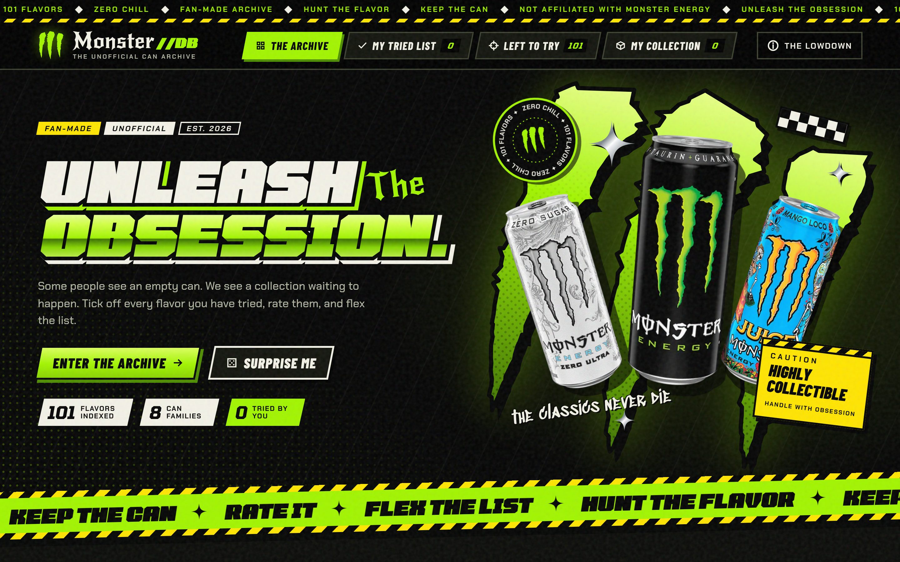
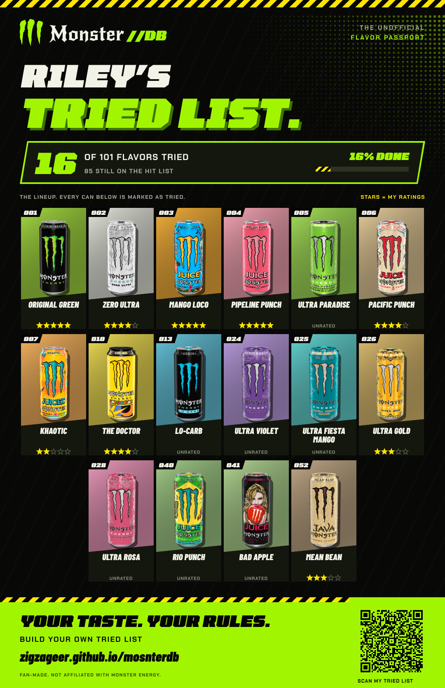

# MonsterDB

A fan-made Monster can archive dressed like a Y2K race livery: black can, toxic green claw rips, wide italic race type, tattoo-gothic accent words, hazard tape, number plates and sticker-thick outlines. The catalog contains 101 flavor entries, each with a real sourced packaging photo, including Red White Blue Razz and Ultra Punk Punch. Includes search, family filters, sorting, can details, a tried list with ratings, and a collection saved in the current browser.



## Look and feel

- **Type:** Tomorrow (wide italic display and numerals), Barlow Condensed (can names, buttons), Chakra Petch (body and labels), New Rocker (the gothic accent word in each headline) and Sedgwick Ave Display (marker scribbles). All are bundled locally.
- **Colour:** each card stage is painted in that can's own colour, so the grid reads as a wall of liveries. Each family also has an accent colour (`familyLivery` in `src/catalog.js`) used by the filter chips.
- **Art:** the claw rips, chrome sparkles, tachometer, spinning badge and barcode are generated in `src/art.js`. Hazard stripes, halftone and grain are CSS. No extra image files are added, which keeps the standalone export working. `src/style.css` may only reference fonts and `data:` URIs.
- **Motion:** hover lifts, a claw strike and stamp when a can is marked tried, and a sweeping tach needle. Everything is switched off under `prefers-reduced-motion`.

## Getting around

- **The archive, My tried list, Left to try, My collection** are four pages. Header tabs on desktop, a fixed bottom tab bar on phones. Opening one from the navigation starts with clean filters at the top of the page. The matching tabs inside the filter bar switch lists without losing your search or family filter.
- The search and family bar sticks to the top while you scroll the grid. Press `/` to jump to search and `Esc` to clear it. Family chips show a small bar of how much of that family you have tried.
- Open a can and step through the current list with **Prev / Next** or the arrow keys. **Surprise me** / **Pick my next can** opens a random flavor you have not tried.
- Changes show a toast with **Undo**, including un-trying a can (which would otherwise drop its rating) and collection changes.

## Tried lists and share cards

- Use **Mark as tried** on a can or in its details. **My tried list** shows your progress on a tachometer with a rank and the next milestone; **Left to try** is a dedicated list showing every remaining flavor. It updates when you mark a can tried and can be bookmarked or shared directly. The collection (**Collect** on a card) is separate: it is for cans you own, and a can can be in both.
- Every can has **1–5 star ratings**, with change and clear controls on the card and in its details. Rating a can you have not marked yet marks it tried in the same tap. Use **Top rated** or **Lowest rated** sorting to review them. Ratings are included in browser storage, personal links and PNG share cards. Marking a can untried removes its rating; **Undo** in the toast brings both back.
- Progress saves automatically in localStorage. **Copy tracking link** creates a compact link that carries the current selection and optional display name. No account, cookie, API key or backend is required.
- A link is a snapshot, not a permanently synchronized account. The address bar updates when you change your own tracker. Copy or bookmark the updated address after changes to preserve the latest state on another device.
- Someone else's link opens in preview mode and leaves your progress untouched. **Use this tracker** restores it on a fresh browser; **Add to my tracker** merges it with existing progress rather than replacing it.
- **Make share card** renders a PNG with every tried can, your name, progress, the website address, and a QR code opening that exact list. Download it or use native image sharing where the browser supports it.
- If browser storage is unavailable, the tracker works for the visit and explains how to keep progress using its link.



The link codec uses the append-only `src/tracking-ids.json` registry. **Never reorder or delete existing IDs.** Append new IDs when adding a can. This keeps older links stable even if the catalog display order changes. Ratings use an optional compact `r` field; older tried-only links remain valid. Remaining-list links add `view=left`. When shared lists are merged, existing personal ratings take priority over conflicting incoming ratings. Invalid links do not replace saved progress.

## GitHub Pages

The repository includes a static build in `docs/`. After the code is pushed:

1. Open the repository's **Settings → Pages**.
2. Select **Deploy from a branch**, branch **main**, folder **/docs**, and **Save**.
3. Wait for the GitHub Pages deployment to finish. The expected address is `https://zigzageer.github.io/mosnterdb/`.

This address is a publishing target until Pages is enabled and the deployment succeeds. Publishing a site does not require changing repository visibility. Private repositories may require a GitHub plan that supports Pages.

Regenerate the committed site after source changes:

```sh
npm ci --no-audit --no-fund
npm run build:pages
npm run test:pages
```

Commit and push the updated `docs/` files along with the source. `.nojekyll` lets Pages serve the Vite build directly. All asset paths are relative, so the app works at the repository subpath. No API keys or backend are needed; product photos and fonts are served locally.

## Development

Use Node.js 22.12+ and npm. Validated with Node.js 24.22.1. The repository `.npmrc` uses a writable project-local `.npm-cache`.

```sh
npm ci --no-audit --no-fund
npm run dev
```

The development server binds to port 5173. In the cloud environment, verify it with `curl -fsS http://127.0.0.1:5173/`. A cloud localhost address is not a public preview URL.

```sh
npm run build
npm test
```

Browser tests use `/usr/bin/chromium` by default; set `CHROMIUM_PATH` to use another Chromium for both the development suite and the production Pages smoke test, for example `CHROMIUM_PATH=/opt/pw-browsers/chromium npm test`. The 26 tests cover every image, official U.S. dataset coverage, filters, search, sorting, collections, tried tracking, compact link round trips, cross-browser restoration, non-destructive shared previews, unavailable storage, PNG downloads, actual QR decoding, full-catalog export, star rating persistence and sorting, backward-compatible rated links, shared-rating merge rules, the dedicated remaining list, keyboard focus and mobile layout. `tests/experience.spec.js` covers the interaction details: one-tap rating, undo, list pages and in-place list tabs, search clearing, stepping through can details, the surprise pick, arrow-key star ratings and the phone tab bar. A separate production smoke test verifies the `/mosnterdb/` path, tracking and PNG generation.

Each cloud task is already isolated. Use the existing checkout; do not create a Git worktree unless explicitly requested. Live server processes must be restarted after restoring an environment snapshot.

## Standalone export

`npm run export:standalone` creates the ignored `MonsterDB.html` with fonts, scripts, styles and images embedded. It can be saved to a computer and opened as a local document in a normal browser. The cloud browser's administrative policy blocks direct file navigation; the earlier export was tested as an offline, in-memory document instead. Browser storage restrictions can affect collection persistence on local files.

## Catalog and credits

`src/catalog.js` holds the flavor index. `src/image-manifest.json` records photo provenance; the 11 original photos are credited in [SOURCES.md](SOURCES.md). `src/official-us-index.json` maps all 52 records from a public U.S. listing snapshot to catalog entries. Ultra Red, Ultra Red White Blue Razz, Rehab Strawberry Lemonade and Juiced Strawberry Lemonade are distinct entries. Every current catalog entry has a packaging photo. Regional can sizes and redesigns vary, and the archive is not yet a complete history of every Monster release. No current/discontinued status or nutrition data is inferred from a photo.

Collections use `monsterdb.collection.v1`, and tried profiles use `monsterdb.tried.v1` in localStorage. Cross-device restoration uses the personal link; live account synchronization is not included.

This independent fan project is not affiliated with Monster Energy. Product imagery and trademarks belong to their respective owners.

## Refresh product images

```sh
python3 scripts/scrape-official.py --source official
```

The official scraper captures product links and their linked image candidates for review, preserves TLS verification and the inherited proxy, and fails clearly if the environment denies access. It does not silently modify the catalog or overwrite historical entries. Candidate downloads are kept in ignored `.image-research/`.

The official site returned a proxy 403 during this update. The public mirrored listing and all 52 associated packshots were fetched successfully instead:

```sh
python3 scripts/scrape-official.py --source public-snapshot --output .image-research/us-snapshot
```

This downloads the public dataset and its photos, with timestamps, source links and content hashes. It is not a fresh scrape of the Monster website. Review and map new entries explicitly, record photo provenance, append tracking IDs, and run the catalog coverage tests before publishing. Current coverage does not establish that every worldwide or historical release is included.
